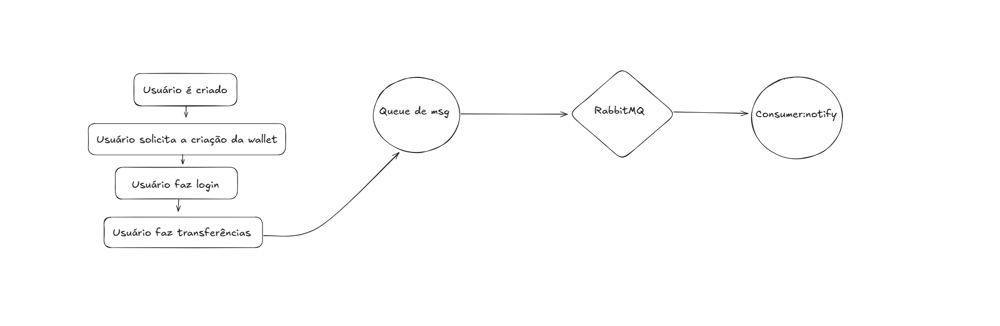
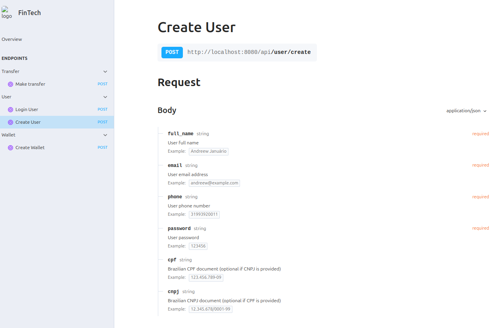
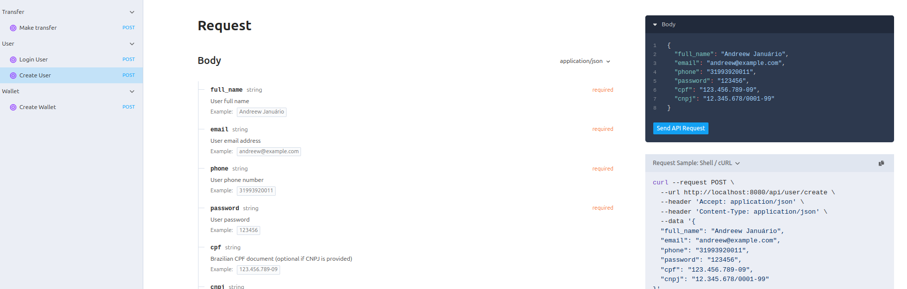

# Fintech MVP

---

## 🇧🇷 PORTUGUÊS

### Sobre o projeto

O principal use case do projeto é a transferência entre dois usuários, um usuário comum e um lojista. 

Antes de finalizar a transferência, um serviço externo deve ser consultado para verificar se ela pode ser aprovada.

Caso a transferência seja autorizada, é feito o envio de notificação por e-mail e por SMS.

Em caso de erro na transferência, um log de erro deve ser registrado e a operação deve ser cancelada.

### Arquitetura e Decisões Técnicas

O objetivo do projeto é criar algo o mais agnóstico possível ao framework.

Optei pelo uso de DDD, utilizando bastante os Object Calisthenics e linguagem ubíqua. Usei também Value Objects para usar a obsessão por tipos primitivos e realizei o tratamento das requisições fora do framework.

Decidi usar o ORM do Laravel para agilizar o desenvolvimento, mas tomei o cuidado de deixá-lo desacoplado, facilitando a troca do ORM futuramente, caso necessário.

Para as chamadas dos provedores de autenticação e envio de notificação, implementei uma lógica com três tentativas. Caso todas falhem, é registrado um log de erro e a mensagem é enviada para uma Dead Letter Queue, aumentando a resiliência do sistema.

Em alguns trechos do código, utilizei chamadas estáticas, principalmente com Log, DB, Event, Auth e nos mappers. Fiz isso de forma intencional e restrita à camada de infraestrutura, onde esse tipo de acesso faz mais sentido.

No caso das facades do Laravel, elas estão encapsuladas dentro de classes adaptadoras (como LaravelLoggerAdapter ou LaravelTransactionManager), garantindo que o restante da aplicação continue desacoplado do framework.

Já nos mappers, o uso de métodos estáticos foi uma escolha prática, pois eles não mantêm estado e servem apenas para converter dados.

Caso o projeto cresça ou surja a necessidade, é possível substituir essas chamadas por injeções de dependência sem impactos, já que tudo está bem isolado.

### Regras de negócio da implementação

- Um usuário precisa ter nome completo, CPF ou CNPJ (único), e-mail (único), telefone e senha (mínimo de 6 caracteres).

- Após o usuário ser criado, ele deve chamar a rota de criação de carteira (Create/Wallet) passando o tipo desejado.

- O que diferencia um lojista de um usuário comum é sua carteira, já que hoje é possível realizar operações como lojista apenas com o CPF.

- Não há rota de saldo, mas é possível editar diretamente a coluna balance da tabela wallets (no seeder, deixei um usuário comum com saldo).

- A principal regra da transferência é que o lojista só pode receber valores, enquanto o usuário comum pode enviar e receber.

- Para fazer uma transferência, o usuário precisa apenas passar o ID do recebedor. O pagador precisa estar logado, pois suas informações já estarão disponíveis.

- Caso a transferência não seja autorizada, o valor não deve ser debitado da conta do pagador, e nenhuma notificação deve ser enviada.

- A transferência é feita de forma síncrona, mas as notificações são enviadas via evento. Esse evento envia as mensagens para o producer no RabbitMQ. Ao serem consumidas, o provedor de notificação é validado e, se houver falha, a mensagem é enviada para a DLQ.

### Fluxo de transferência

1. Criação dos usuários.
2. Criação das wallets dos usuários.
3. Transferência entre wallets passando o ID do recebedor.
4. Ativação das filas para envio das notificações.
5. Ativação do consumer ```consumer:notify ``` para o consumo das notificações.



### Configuração do projeto e comandos necessários

#### Configuração Docker

Permissão para executar os scripts
```bash
chmod +x setup.sh
chmod +x docker/wait-for-it.sh
```

Automação com os passos necessários para subir o projeto
```bash
./setup.sh
```

#### Documentação da API

Assim que o projeto estiver pronto, basta acessar:
```bash
http://localhost:8080/docs/api/
```
A documentação foi feita com a lib Scramble e nela tem um exemplo de request body para cada endpoint, onde é possível copiar e colar o curl.

Mas também deixo um arquivo na raiz do projeto dentro da pasta 'Dev' onde está o arquivo de exportação do insominia em dois formatos.

O insominia costuma a remover as automações, mas basta inserir em Auth:




##### Usuários do seeder
Type : Common
Balance : 100000
```bash
{
	"email": "andreew@gmail.com",
	"password": "123456"
}
```
Type : shop_kepeer
Balance : 0
```bash
{
	"email": "alecssander@gmail.com",
	"password": "123456"
}
```

#### RabbitMQ

``` http://localhost:15672/ ```
```bash
{
	"Username": "guest",
	"password": "guest"
}
```

#### CI/CD

Assim que um push for para a branch main ele vai rodar o php stan e os testes.
Se preferir rodar separadamente, seguem os comandos:

##### Phpstan

```bash
docker exec -it app php artisan phpstan:analyse
```

##### Testes

Para rodar o phpstan os testes basta rodar o comando abaixo
No sail
```bash
docker exec -it app php artisan test
```

#### Queue
Para rodar o queue basta rodar o comando abaixo
```bash
docker exec -it app php artisan queue:work
```

#### Consumer
Para consumir as notificações basta rodar o comando abaixo
```bash
docker exec -it app php artisan consumer:notify
```

### O que eu faria para melhorar o projeto no futuro

- Melhoraria a observabilidade com o monolog e talvez um sentry/newrelic.
- Usaria swoole em um projeto de microserviços atuando como consumer.
- Se o volume de mensagens alterar, seria melhor utilizar o kafka.
- Elevaria o nível do PhpStan para no mínimo 6.
- Utilizar a lib https://github.com/brick/money para ter mais confiabilidade nas operações matemáticas.

---

## 🇬🇧 ENGLISH

### About the Project

The main use case of the project is the transfer between two users: a regular user and a merchant.

Before finalizing the transfer, an external service must be consulted to verify if it can be approved.

If the transfer is authorized, notifications are sent via email and SMS.

In case of transfer error, an error log should be registered and the operation should be cancelled.

### Architecture and Technical Decisions

The goal of the project is to create something as framework-agnostic as possible.

I chose to use DDD, extensively using Object Calisthenics and ubiquitous language. I also used Value Objects to embrace primitive obsession and handled requests outside of the framework.

I decided to use Laravel's ORM to speed up development, but I was careful to keep it decoupled, making it easy to swap the ORM in the future if needed.

For authentication provider calls and notification sending, I implemented a logic with three retry attempts. If all fail, an error log is registered and the message is sent to a Dead Letter Queue, increasing system resilience.

In some parts of the code, I used static calls, mainly with Log, DB, Event, Auth and in mappers. I did this intentionally and restricted it to the infrastructure layer, where this type of access makes more sense.

In the case of Laravel facades, they are encapsulated within adapter classes (such as LaravelLoggerAdapter or LaravelTransactionManager), ensuring that the rest of the application remains decoupled from the framework.

For mappers, the use of static methods was a practical choice, as they do not maintain state and serve only to convert data.

Should the project grow or the need arise, it's possible to replace these calls with dependency injection without impact, as everything is well isolated.

### Business Rules Implementation

- A user must have a full name, CPF or CNPJ (unique), email (unique), phone and password (minimum 6 characters).

- After the user is created, they must call the wallet creation route (Create/Wallet) specifying the desired type.

- What differentiates a merchant from a regular user is their wallet, as it's possible to perform operations as a merchant with just a CPF.

- There is no balance route, but it's possible to directly edit the balance column of the wallets table (in the seeder, I left a regular user with a balance).

- The main transfer rule is that the merchant can only receive values, while the regular user can send and receive.

- To make a transfer, the user only needs to pass the recipient's ID. The payer must be logged in, as their information will already be available.

- If the transfer is not authorized, the value should not be debited from the payer's account, and no notification should be sent.

- The transfer is done synchronously, but notifications are sent via events. This event sends messages to the producer in RabbitMQ. When consumed, the notification provider is validated and, if it fails, the message is sent to the DLQ.

### Transfer Flow

1. Creation of users.
2. Creation of users' wallets.
3. Transfer between wallets by passing the recipient's ID.
4. Activation of queues for sending notifications.
5. Activation of the ```consumer:notify``` consumer to consume notifications.


### Project Setup and Required Commands

#### Docker Configuration

Permission to execute scripts
```bash
chmod +x setup.sh
chmod +x docker/wait-for-it.sh
```

Automation with the necessary steps to start the project
```bash
./setup.sh
```

#### API Documentation

Once the project is ready, simply access:
```bash
http://localhost:8080/docs/api/
```
The documentation was created with the Scramble lib and it has an example of request body for each endpoint, where you can copy and paste the curl.

I also left a file in the root of the project inside the 'Dev' folder where the insomnia export file is in two formats.

Insomnia usually removes automations, but just insert in Auth:


##### Seeder Users
Type : Common
Balance : 100000
```bash
{
	"email": "andreew@gmail.com",
	"password": "123456"
}
```
Type : shop_kepeer
Balance : 0
```bash
{
	"email": "alecssander@gmail.com",
	"password": "123456"
}
```

#### RabbitMQ

``` http://localhost:15672/ ```
```bash
{
	"Username": "guest",
	"password": "guest"
}
```

#### CI/CD

Whenever a push is made to the main branch, it will run phpstan and tests.
If you prefer to run them separately, here are the commands:

##### Phpstan

```bash
docker exec -it app php artisan phpstan:analyse
```

##### Tests

To run phpstan and tests just run the command below
On sail
```bash
docker exec -it app php artisan test
```

#### Queue
To run the queue just run the command below
```bash
docker exec -it app php artisan queue:work
```

#### Consumer
To consume the notifications just run the command below
```bash
docker exec -it app php artisan consumer:notify
```

### Future Improvements

- I would improve observability with monolog and perhaps sentry/newrelic.
- I would use swoole in a microservices project acting as a consumer.
- If the message volume increases, it would be better to use kafka.
- I would raise the PhpStan level to at least 6.
- Use the lib https://github.com/brick/money for more reliability in mathematical operations.
